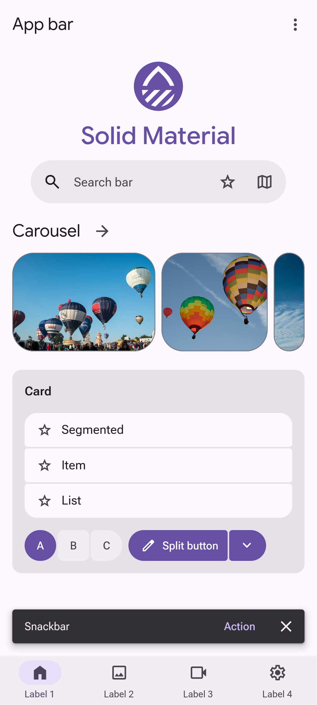
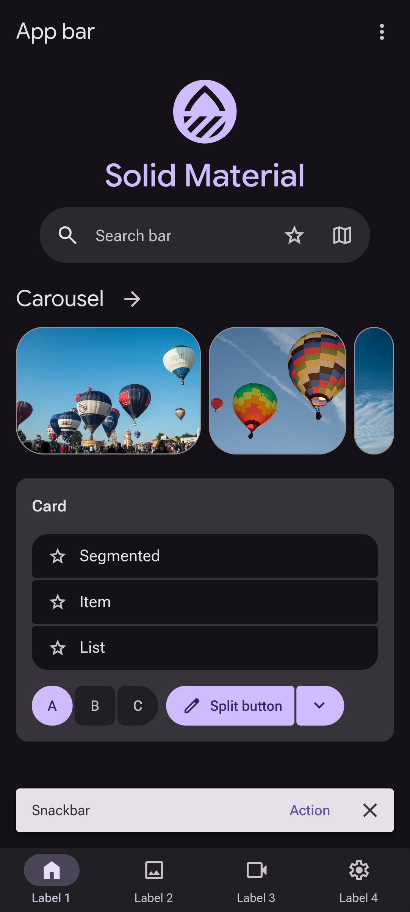

<div align="center">
  <a href="https://solid-material.sites.deploybase.eu" target="_blank" rel="noreferrer">
    <picture>
      <source media="(prefers-color-scheme: dark)" srcset="docs/images/logo-dark.svg" />
      <source media="(prefers-color-scheme: light)" srcset="docs/images/logo-light.svg" />
      
    </picture>
  </a>
</div>

<br />

<div align="center">

[](https://npmjs.com/package/@solidmaterial/material)
[](https://github.com/mprovok/solid-material/actions/workflows/ci.yml)
[](https://codecov.io/gh/mprovok/solid-material)
[][url-storybook]

</div>

# Solid Material

> Material 3 Expressive components built for SolidJS

Solid Material is a component library implementing [Material 3 Expressive][url-m3] using [SolidJS][url-solid].
It provides components closely following the guidelines of Material 3 Expressive.

<div align="center">


</div>

## ✨ Features

- **Material 3 Expressive:** Components implementing the M3 Expressive spec

- **Layout Components:** Responsive components for navigation (rail and bar) and content in multiple panes

- **Dynamic Theming:** Baseline and dynamic color schemes based on a source color

- **Design Tokens:** Includes tokens for easings, springs, and static palette color tokens for 11 colors

- **View Transitions:** Animated transitions between pages using the View Transitions API

- **Few dependencies**: Avoids external dependencies as much as possible by making use of modern CSS features like
  scroll-driven animations and anchor positioning

## 🚀 Quick Start

Add the components and icons to your SolidJS project:

```bash
pnpm add @solidmaterial/material @solidmaterial/icons
```

Add the Vite plugin to be able to import SVG files as SolidJS components:

```bash
pnpm add -D @solidmaterial/vite-plugin-solid-svg
```

vite.config.ts:

```ts
import solidSvg from '@solidmaterial/vite-plugin-solid-svg';
import { defineConfig } from 'vite';
import solidPlugin from 'vite-plugin-solid';

export default defineConfig({
  plugins: [solidPlugin(), solidSvg()]
});
```

src/index.tsx:

```tsx
import { MaterialButton } from '@solidmaterial/material/components/button';
import { MaterialCard, MaterialCardBody } from '@solidmaterial/material/components/card';
import { H1 } from '@solidmaterial/material/components/typography';
import { MaterialTheme } from '@solidmaterial/material/styling';
import { render } from 'solid-js/web';

import TotalDissolvedSolidsIcon from '@solidmaterial/icons/400/outlined/total_dissolved_solids.svg';

const App = () => {
  return (
    <MaterialTheme>
      <main style={{ margin: '1rem' }}>
        <MaterialCard variant="elevated" size="extra-large">
          <MaterialCardBody>
            <section style={{ display: 'flex', 'flex-direction': 'column', gap: '1rem', 'align-items': 'center' }}>
              <TotalDissolvedSolidsIcon width={128} height={128} fill="var(--md-sys-color-on-surface)" />
              <H1 role="headline" size="medium">
                Material 3 Expressive with Solid Material
              </H1>
              <MaterialButton
                variant="filled"
                size="medium"
                href="https://solid-material.sites.deploybase.eu/get-started"
              >
                Get started
              </MaterialButton>
            </section>
          </MaterialCardBody>
        </MaterialCard>
      </main>
    </MaterialTheme>
  );
};

render(() => <App />, document.querySelector('#root')!);
```

## 📖 Documentation

You can read more detailed instructions on how to display navigation components (like the navigation rail and bar)
or how to put your content in flexible or fixed panes on the [Get Started][url-get-started] page.

To view all the components you can use, visit the [Storybook][url-storybook] site.

## 📦 Packages

| Package                                             | Description                                                                       |
| --------------------------------------------------- | --------------------------------------------------------------------------------- |
| [@solidmaterial/material][url-sm-material]          | Core and layout components for M3 Expressive, design tokens, and view transitions |
| [@solidmaterial/icons][url-sm-icons]                | Icons from Material Symbols as SVG files                                          |
| [@solidmaterial/vite-plugin-solid-svg][url-sm-vite] | Vite plugin to import SVG files as SolidJS components                             |

## 🛠️ Development

```bash
pnpm install # Install dependencies
pnpm dev # Run development environment of the landing page

pnpm build # Create a production build of the packages
pnpm preview # View the production build of the landing page

pnpm lint # Run oxlint on all packages
pnpm format:check # Check formatting using oxfmt
pnpm format # Format all files using oxfmt

pnpm install:webkit # Install the WebKit browser needed to run the tests
pnpm test # Run the tests of all packages
```

## ❤️ Credits

This project uses the web components of [@material/web][url-material-web] for
the ripple, focus ring, and elevation effects, and for some of the components
often used in forms (like the checkbox, text field, etc.), these are mere bindings
around the respective web components.
See the [README.md][url-sm-material] file for the exact list.

The [Material Symbols][url-google-mdi] in [@solidmaterial/icons][url-sm-icons] were made by Google.

Many of the SolidJS components make use of the primitives from [Solid Primitives][url-solid-primitives].
Much thanks to their contributors.

## 🤖 AI?

The components (TypeScript and CSS) in [@solidmaterial/material][url-sm-material] were handcrafted,
but files which don't end up in its production build (like the calculator demo app) may
or may not have been partially assisted by small LLMs.

## 📜 License

This project is licensed under the Apache 2.0 license.

[url-get-started]: https://solid-material.sites.deploybase.eu/get-started
[url-google-mdi]: https://github.com/google/material-design-icons
[url-material-web]: https://material-web.dev/
[url-m3]: https://m3.material.io/
[url-sm-material]: https://github.com/mprovok/solid-material/tree/main/packages/material#readme
[url-sm-icons]: https://github.com/mprovok/solid-material/tree/main/packages/icons#readme
[url-sm-vite]: https://github.com/mprovok/solid-material/tree/main/packages/vite-plugin-solid-svg#readme
[url-solid]: https://www.solidjs.com/
[url-solid-primitives]: https://primitives.solidjs.community/
[url-storybook]: https://solid-material.sites.deploybase.eu/storybook/
